# Hindi and Nepali Decoder-only LMs from Scratch

**LMA Individual Project** | Gopal Kataria

Two decoder-only Transformer language models, one for **Hindi** and one for **Nepali**, built ground-up. Data collection, tokenization, model code, pretraining, and reasoning fine-tuning are all implemented from **scratch** in this repository.

## Architecture

```mermaid
flowchart LR
    A[Raw Hindi / Nepali<br/>Web Corpora] --> B[Cleaning, Language ID<br/>Dedup, Quality Filter]
    B --> C[Subword Tokenizer<br/>Trained from Scratch]
    C --> D[Tokenized Shards<br/>Train / Val Splits]
    D --> E

    subgraph E[Decoder-only Transformer - PyTorch]
        direction LR
        E1[Token Embedding<br/>+ Positional Enc.] --> E2[N x Block<br/>Causal MHA, Norm,<br/>FFN, Residual]
        E2 --> E3[Final Norm<br/>+ LM Head]
    end

    E --> F[Pretraining<br/>Next-Token Prediction]
    F --> G[Base Checkpoints<br/>hi / ne]
    G --> H[Reasoning Fine-tuning<br/>CoT / Instruction Data]
    H --> I[Evaluation<br/>PPL + Reasoning Benchmarks]
```



## What "from scratch" means here

| Stage | What is built |
|---|---|
| **Data** | Custom crawl and ingestion, Unicode normalization for Devanagari, language ID filtering, near-duplicate removal, and heuristic quality scoring. Corpora are curated per language, not pulled from a prepackaged dataset. |
| **Tokenizer** | Subword vocabulary trained from scratch on the cleaned corpora, tuned for conjuncts and matras to keep token fertility low in both languages. |
| **Model** | Decoder-only Transformer in pure PyTorch: causal multi-head attention, positional encoding, normalization, residual blocks, and weight-tied LM head, all written at the tensor level. |
| **Training loop** | Hand-written loop with mixed precision, gradient accumulation, gradient clipping, warmup + cosine LR schedule, and resumable checkpointing. |
| **Pretraining** | Random initialization, next-token prediction, per-language held-out perplexity tracking. |
| **Reasoning fine-tuning** | Post-training of the base models on curated instruction and chain-of-thought data, turning fluent generators into step-by-step reasoners in a low-resource setting. |


## Phases

1. **Pretraining:** base Hindi and Nepali LMs trained from random init.
2. **Fine-tuning:** instruction adaptation of the base checkpoints.
3. **Reasoning:** chain-of-thought post-training and benchmark evaluation.

## Models

- **Model H:** Hindi (`hi`), higher-resource language
- **Model L:** Nepali (`ne`), lower-resource language

## Links

### Corpus

[Corpus Drive Folder](https://drive.google.com/drive/folders/1W5IcGslCwV7zTKIDFokKLg28qfrp4uGY?usp=sharing&utm_source=chatgpt.com)

### Phase 2

* **Hindi Model H:** [Hugging Face - Hindi](https://huggingface.co/bropal/lma-project?utm_source=chatgpt.com)
* **Nepali Model L:** [Hugging Face - Nepali](https://huggingface.co/bropal/lma-project-nepali?utm_source=chatgpt.com)

### Phase 3

* **Hindi:** [Hugging Face - Hindi Phase 3](https://huggingface.co/bropal/lma-hi-phase3?utm_source=chatgpt.com)
* **Nepali:** [Hugging Face - Nepali Phase 3](https://huggingface.co/bropal/lma-ne-phase3?utm_source=chatgpt.com)

---

# Repository Structure

```text
.
├── crawler/                  # Web crawler
├── hindi/
│   ├── data/                 # Hindi data and preprocessing
│   ├── tokenizer/            # Hindi tokenizer
│   └── model/                # Hindi Phase 2 model
├── nepali/
│   ├── data/                 # Nepali data and preprocessing
│   ├── tokenizer/            # Nepali tokenizer
│   └── model/                # Nepali Phase 2 model
├── reasoning-sft/             # Phase 3 reasoning SFT
├── scripts/                  # Evaluation and reporting scripts
├── eval_results/             # Evaluation results
├── kaggle.ipynb              # Phase 2 training notebook
└── repl.py                   # Model REPL
```

---

# Phase 1: Data and Tokenizers

## 1. Environment Setup

```bash
uv sync
source .venv/bin/activate
```

## 2. Download and Extract the Corpus

Download the corpus archive from the Drive link above and extract it:

```bash
./scripts/unzip_corpora.sh corpora_dataset_bundle.tar.gz
```

This creates the required files under:

```text
hindi/data/
nepali/data/
```

## 3. Run the Web Crawler

The crawler is in `crawler/`.

### Nepali

```bash
python3 crawler/cli.py crawl \
  --config nepali/configs/sources.yaml \
  --output nepali/data/raw/clean/nepali_corpus.jsonl \
  --db crawl_state_nepali.db
```

### Hindi

```bash
python3 crawler/cli.py crawl \
  --config hindi/configs/sources.yaml \
  --output hindi/data/raw/clean/hindi_corpus.jsonl \
  --db crawl_state_hindi.db
```

## 4. Clean the Dataset

The cleaning pipeline performs Unicode normalization, boilerplate removal, language filtering, exact deduplication, and MinHash/LSH near-duplicate removal.

### Hindi

```bash
python3 scripts/clean_hindi.py \
  hindi/data/raw/clean/hindi_corpus.jsonl \
  -o hindi/data/raw/clean/
```

### Nepali

```bash
python3 scripts/clean_hindi.py \
  nepali/data/raw/clean/nepali_corpus.jsonl \
  -o nepali/data/raw/clean/ \
  --langs ne
```

## 5. Create Train, Validation and Test Splits

The datasets are combined with curated public datasets and split into **90/5/5 train/validation/test splits**.

```bash
python3 scripts/split_and_stats.py
```

Language-specific preprocessing can also be run using:

```bash
python3 hindi/data/preprocess.py
python3 nepali/data/preprocess.py
```

Outputs:

```text
hindi/data/
├── train.jsonl
├── val.jsonl
├── test.jsonl
└── dataset_stats.json

nepali/data/
├── train.jsonl
├── val.jsonl
├── test.jsonl
└── dataset_stats.json
```

## 6. Train Tokenizers

BPE tokenizers are trained from scratch with different vocabulary sizes.

### Hindi

```bash
python3 hindi/tokenizer/train.py
```

For a specific tokenizer:

```bash
uv run tokenizer train \
  --lang hi \
  --input hindi/data/train.jsonl \
  --merges 20000 \
  --output-dir hindi/tokenizer/artifacts_20000 \
  --name bpe_hi_20000
```

### Nepali

```bash
python3 nepali/tokenizer/train.py
```

For a specific tokenizer:

```bash
uv run tokenizer train \
  --lang ne \
  --input nepali/data/train.jsonl \
  --merges 20000 \
  --output-dir nepali/tokenizer/artifacts_20000 \
  --name bpe_ne_20000
```

## 7. Evaluate Tokenizers

Tokenizer evaluation measures:

* Fertility
* Bytes per token
* Compression ratio
* Continuation rate
* UNK rate
* Throughput

Run evaluation for both languages:

```bash
python3 scripts/evaluate_tokenizers.py
```

Or separately:

```bash
python3 hindi/tokenizer/evaluate.py
python3 nepali/tokenizer/evaluate.py
```

Interactive evaluation:

```bash
uv run tokenizer evaluate --lang hi --samples 1000
uv run tokenizer evaluate --lang ne --samples 1000
```

## 8. Generate Statistics and Figures

```bash
python3 scripts/generate_report_stats.py
```

---

# Phase 2: Language Model Training

Phase 2 trains the decoder-only Transformer models.

Training was done on **Kaggle** using:

```text
kaggle.ipynb
```

The notebook uses the datasets and checkpoints listed in the links section.

The final checkpoints and tokenized datasets are available on Hugging Face.

## Hindi CLI

Train:

```bash
uv run lma-train-hindi \
  [--config path/to/model_h.yaml] \
  [--checkpoint path/to/checkpoint.pt]
```

Evaluate:

```bash
uv run lma-eval-hindi \
  [--config path/to/model_h.yaml] \
  [--checkpoint path/to/best_model.pt] \
  [--prompts "नमस्ते" "hello"]
```

Generate text:

```bash
uv run lma-generate \
  [--config path/to/model_h.yaml] \
  [--checkpoint path/to/final_model.pt] \
  [--prompts "नमस्ते"]
```

## Run the REPL

```bash
uv run repl.py
```

Before running, edit `repl.py` and set the paths for the required:

```text
tokenizer
model.pt
```

---

# Phase 3: Reasoning SFT

Phase 3 fine-tunes the Phase 2 models on reasoning data.

Training was done on **Kaggle** using:

```text
reasoning-sft/kaggle.ipynb
```

The reasoning dataset is generated using the dataset generation code in `reasoning-sft/`.

The Phase 2 training output is used to select the checkpoint for Phase 3.

The Phase 3 checkpoints are available in the links section.

## Run the REPL

```bash
uv run repl.py
```

Edit `repl.py` to point to the required:

```text
tokenizer
model.pt
```

---

# Evaluation

All evaluation-related code is in:

```text
scripts/
```

Results are stored in:

```text
eval_results/
```

This includes the evaluation outputs and figures generated for the different phases.
