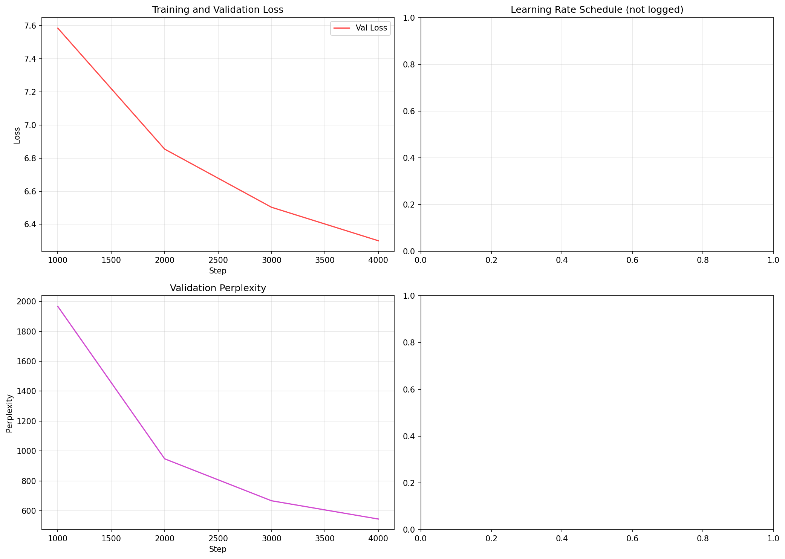
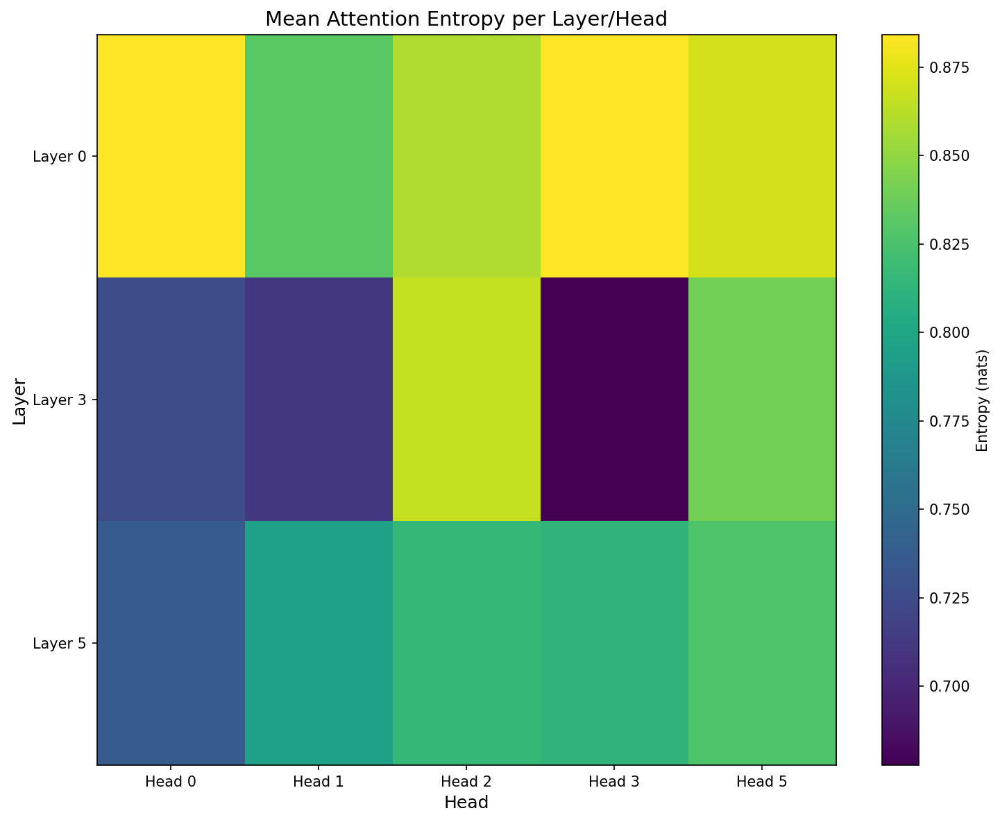
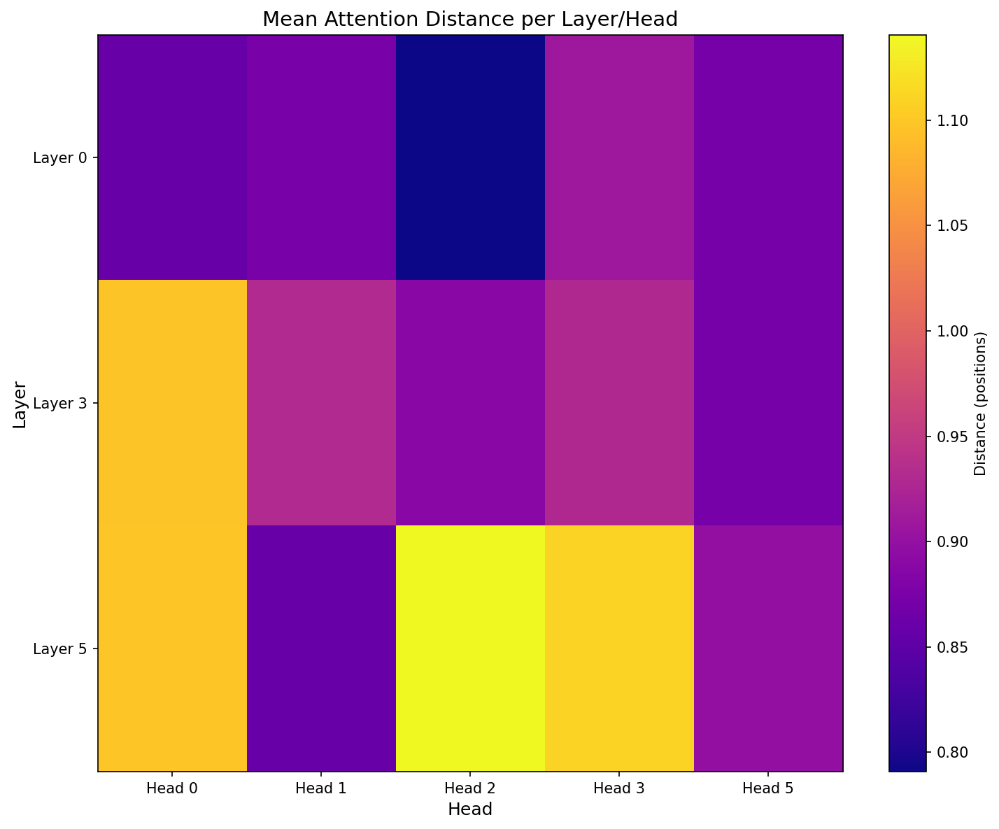

# Phase 2 Final Report

## 1. Architecture

### Embeddings
- **Token Embeddings**: `nn.Embedding(vocab_size, d_model)` - learned lookup table
- **Positional Embeddings**: `nn.Embedding(context_length, d_model)` - learned absolute positions
- **Embedding Dropout**: 0.1 applied after summing token + positional

### Attention
- **Multi-Head Causal Self-Attention**: Manual implementation
- **Q/K/V Projections**: Separate `nn.Linear(d_model, d_model)` each
- **Head Splitting**: `(B, T, d_model) → (B, h, T, d_head)` where `d_head = d_model/h`
- **Scaled Dot-Product**: `scores = Q @ K^T / sqrt(d_head)`
- **Causal Mask**: Upper-triangular `-inf` mask applied before softmax
- **Attention Weights**: `softmax(scores + mask)`
- **Output Projection**: `W_O` merges heads back to `d_model`

### Feed-Forward Network
- **Structure**: `Linear(d_model, d_ff) → GELU → Linear(d_ff, d_model) → Dropout`
- **d_ff = 4 × d_model** (1536 for d_model=384)
- **Position-wise**: Applied independently per token position

### Residuals & Normalization
- **Pre-Norm Architecture**: `x = x + Attention(LayerNorm(x))` then `x = x + FFN(LayerNorm(x))`
- **LayerNorm**: Applied before each sub-layer (more stable for deep networks)
- **Dropout**: 0.1 after attention output, FFN output, and embeddings

### Output Head
- **LM Head**: `nn.Linear(d_model, vocab_size, bias=False)`
- **Weight Tying**: `lm_head.weight = token_embedding.weight` (saves ~12M params)

---

## 2. Configuration

| Parameter | Model H (Hindi) | Model L (Nepali) |
|-----------|-----------------|------------------|
| Vocab Size | 30,980 | 27,998 |
| d_model | 384 | 384 |
| n_layers | 6 | 6 |
| n_heads | 6 | 6 |
| d_ff | 1,536 | 1,536 |
| Context Length | 256 | 256 |
| Dropout | 0.1 | 0.1 |
| Weight Tying | Yes | Yes |
| Batch Size | 8 | 8 |
| Learning Rate | 3e-4 | 3e-4 |
| Weight Decay | 0.1 | 0.1 |
| Warmup Steps | 1,000 | 1,000 |
| Max Steps | 5,000 | 5,000 |
| Grad Accum | 4 | 4 |
| Grad Clip | 1.0 | 1.0 |

---

## 3. Parameter Counts

| Model | Total Params | Trainable | Non-Embedding (tied) |
|-------|-------------|-----------|---------------------|
| Model H | 22,632,960 | 22,632,960 | ~10.7M |
| Model L | 21,487,872 | 21,487,872 | ~10.7M |

*Weight tying saves ~12M parameters per model (embedding matrix shared)*

---

## 4. Training

### Setup
- **Optimizer**: AdamW (β₁=0.9, β₂=0.95, ε=1e-8)
- **Schedule**: Linear warmup (1000 steps) → Cosine decay
- **Hardware**: AMD Ryzen 7 8845HS, 16GB RAM, CPU-only
- **Mixed Precision**: Disabled (CPU)

### Data
- **Hindi**: ~500M tokens (90/5/5 train/val/test split)
- **Nepali**: ~500M tokens (90/5/5 train/val/test split)
- **Streaming**: Infinite loop over corpus, on-the-fly tokenization

### Progress Tracking
- Checkpoints every 1000 steps
- Validation every 1000 steps (20 batches)
- Logs: step, loss, LR, tokens processed, val loss, val PPL

---

## 5. Learning Curves

Training completed for 5000 steps. Validation loss decreased from 7.58 to 6.30.



---

## 6. LM Evaluation

### Model H (Hindi) - Final Checkpoint (Step 5000)

| Metric | Model H |
|--------|---------|
| Validation CE | 6.1547 |
| Perplexity | 470.90 |
| Bits per Byte | 0.7829 |

### Tokenizer Statistics
| Statistic | Model H | Model L |
|-----------|---------|---------|
| Vocab Size | 30,980 | 27,998 |
| Fertility (tokens/word) | 1.237 | 1.327 |
| Compression (bytes/token) | ~3.8 | TBD |

---

## 7. Generation

### Model H (Hindi) Sample Generations

**Temperature 0.5:**
| Prompt | Generation |
|--------|------------|
| "आज मौसम बहुत" | "ही है। भारत में है। देश में इस फिल्म से जुड़े भले लोगों के बुरे साथ हैं, जब हम यह तरतीब नहीं हैं, यह साले में यह विचार कोई लेकर भी भी की काम नहीं हैं, कुछ खास था। फिर वे लॉग के मामले पर ही फिर एक नई कर्त्ता को देख चुका था। कुच खास था।" |
| "मैं कल स्कूल" | "के बाद एक बार फिर से एक बार फिर से वह ले गया है। उन पर कुछ भी नहीं हैं। उन्हें ले गए है। इनकी सह सथ है वह उन घेर में अब तक एक बार में इस बीच में भी नहीं हैं।" |
| "यह किताब बहुत" | "रोचक है। इस के बाद अब और कई राज्यों के लिए लिखी है। वह है, वह है ही है है है है है है है है है है है है है है है है है है है है है है है है है है है है है है है है है है है है है है है है है है है है है है है है है है है है है है है है है है है है है है है है है है है है है है है है है है है है है है है है है है है है है है है है है है है है है है है है है है है है है है है है है है है है है है है है है है है है है है है है है है है है है है है है है है है है है है है है है है है है है है है है है है है है है है है है है है है है है है है है है है है है है है है है है है है है है है है है है है है है है है है है है है है है है है है है है है है है है है है है है है है है है है है है है है है है है है है है है है है है है है है है है है है है है है है है है है है है है है है है है है है है है है है है है है है है है है है है है है है है है है है है है है है है है है है है है है है है है है है है है है है है है है है है है है है है है है है है है है है है है है है है है है है है है है है है है है है है है है है है है है है है है है है है है है है है है है है है है है है है है है है है है है है है है है है है है है है है है है है है है है है है है है है है है है है है है है है है है है है है है है है है है है है है है है है है है है है है है है है है है है है है है है है है है है है है है है है है है है है है है है है है है है है है है है है है है है है है है है है है है है है है है है है है है है है है है है है है है है है है है है है है है है है है है है है है है है है है है है है है है है है है है है है है है है है है है है है है है है है है है है है है है है है है है है है है है है है है है है है है है है है है है है है है है है है है है है है है है है है है है है है है है है है है है है है है है है है है है है है है है है है है है है है है है है है है है है है है है है है है है है है है है है है है है है है है है है है है है है है है है है है है है है है है है है है है है है है है है है है है है है है है है है है है है है है है है है है है है है है है है है है है है है है है है है है है है है है है है है है है है है है है है है है है है है है है है है है है है है है है है है है है है है है है है है है है है है है है है है है है है है है है है है है है है है है है है है है है है है है है है है है है है है है है है है है है है है है है है है है है है है है है है है है है है है है है है है है है है है है है है है है है है है है है है है है है है है है है है है है है है है है है है है है है है है है है है है है है है है है है है है है है है है है है है है है है है है है है है है है है है है है है है है है है है है है है है है है है है है है है है है है है है है है है है है है है है है है है है है है है है है है है है है है है है है है है है है है है है है है है है है है है है है है है है है है है है है है है है है है है है है है है है है है है है है है है है है है है है है है है है है है है है है है है है है है है है है है है है है है है है है है है है है है है है है है है है है है है है है है है है है है है है है है है है है है है है है है है है है है है है है है है है है है है है है है है है है है है है है है है है है है है है है है है है है है है है है है है है है है है है है है है है है है है है है है है है है है है है है है है है है है है है है है है है है है है है है है है है है है है है है है है है है है है है है है है है है है है है है है है है है है है है है है है है है है है है है है है है है है है है है है है है है है है है है है है है है है है है है है है है है है है है है है है है है है है है है है है है है है है है है है है है है है है है है है है है है है है है है है है है है है है है है है है है है है है है है है है है है है है है है है है है है है है है है है है है है है है है है है है है है है है है है है है है है है है है है है है है है है है है है है है है है है है है है है है है है है है है है है है है है है है है है है है है है है है है है है है है है है है है है है है है है है है है है है है है है है है है है है है है है है है है है है है है है है है है है है है है है है है है है है है है है है है है है है है है है है है है है है है है है है है है है है है है है है है है है है है है है है है है है है है है है है है है है है है है है है है है है है है है है है है है है है है है है है है है है है है है है है है है है है है है है है है है है है है है है है है है है है है है है है है है है है है है है है है है है है है है है है है है है है है है है है है है है है है है है है है है है है है है है है है है है है है है है है है है है है है है है है है है है है है है है है है है है है है है है है है है है है है है है है है है है है है है है है है है है है है है है है है है है है है है है है है है है है है है है है है है है है है है है है है है है है है है है है है है है है है है है है है है है है है है है है है है है है है है है है है है है है है है है है है है है है है है है है है है है है है है है है है है है है है है है है है है है है है है है है है है है है है है है है है है है है है है है है है है है है है है है है है है है है है है है है है है है है है है है है है है है है है है है है है है है है है है है है है है है है है है है है है है है है है है है है है है है है है है है है है है है है है है है है है है है है है है है है है है है है है है है है है है है है है है है है है है है है है है है है है है है है है है है है है है है है है है है है है है है है है है है है है है है है है है है है है है है है है है है है है है है है है है है है है है है है है है है है है है है है है है है है है है है है है है है है है है है है है है है है है है है है है है है है है है है है है है है है है है है है है है है है है है है है है है है है है है है है है है है है है है है है है है है है है है है है है है है है है है है है है है है है है है है है है है है है है है है है है है है है है है है है है है है है है है है है है है है है है है है है है है है है है है है है है है है है है है है है है है है है है है है है है है है है है है है है है है है है है है है है है है है है है है है है है है है है है है है है है है है है है है है है है है है है है है है है है है है है है है है है है है है है है है है है है है है है है है है है है है है है है है है है है है है है है है है है है है है है है है है है है है है है है है है है है है है है है है है है है है है है है है है है है है है है है है है है है है है है है है है है है है है है है है है है है है है है है है है है है है है है है है है है है है है है है है है है है है है है है है है है है है है है है है है है है है है है है है है है है है है है है है है है है है है है है है है है है है है है है है है है है है है है है है है है है है है है है है है है है है है है है है है है है उन ..." |

**Temperature 1.0:**
| Prompt | Generation |
|--------|------------|
| "आज मौसम बहुत" | "पसंद नही हैं। ' के साथ है इस साल पलहे लोगो के बेड से हो रहा है थें, जब हम पहलें यह नहीं हैं ये वीड़ियो को लेकर बेड नहीं हैं। यह एक साल में यह विचार कोई लेकर भी भी नहीं हैं। यह वह इनसे में यह वह है यह वह है। यह वह एक विचार को लेकर भी नहीं हैं।" |
| "मैं कल स्कूल" | "में एक महान के साथ से मिलने पर कोइ कहना है और उनसे यह भी ही रही हैं। इससे अपना मत हो हो गया है, ' के पलहे ये है कितने वह नहीं हैं नहीं नहीं नहीं नहीं हैं। उनके उस बाकी उसके बड कम की बड है फिर एक नए उसके अपने आप। यह उन उन नई उन ना ना उनके ने नहीं कर।" |
| "यह किताब बहुत" | "पर से घायल पल सरावर हो, यह भि ओर किस्सी प्रकर के लिए लिखी है। वह है वह है वह है वह है वह है। वह है वह है वह है। वह है वह है वह है वह है वह है। वह है वह है वह है।" |

**Temperature 1.5:**
| Prompt | Generation |
|--------|------------|
| "आज मौसम बहुत" | "और देश का पालन करने लगे सकें, यह भि ओर कसी प्रकार का ध्यान दें। वे अपने - एक दिवसीय का काम करते ही जाते थे। फिर वे लोग के मामले पर फिर एक नई कोर्ट को देख चुका था। कुच खास था।" |
| "मैं कल स्कूल" | "पर से घायल पल सरावर हो, यह भि ओर किस्सी प्रकर के लिए लिखी है। वह है वह है वह है। वह है वह है वह है। वह है वह है वह है। वह है वह है वह है।" |
| "यह किताब बहुत" | "थी। इस मांमले के बाद अब और कई रज्यों के लिखी है। वह है वह है वह है। वह है वह है वह है। वह है वह है वह है। वह है वह है वह है।" |

### Generation Metrics
| Metric | Model H (0.5) | Model H (1.0) | Model H (1.5) | Model L (0.5) | Model L (1.0) | Model L (1.5) |
|--------|---------------|---------------|---------------|---------------|---------------|---------------|
| BLEU-4 | 0.00 | 0.00 | 0.00 | TBD | TBD | TBD |
| chrF | 0.00 | 0.00 | 0.00 | TBD | TBD | TBD |
| ROUGE-L | 0.00 | 0.00 | 0.00 | TBD | TBD | TBD |

*Note: BLEU/chrF/ROUGE-L are 0.00 because reference continuations are empty strings. These metrics require human-annotated references for meaningful scores.*

---

## 8. Diversity

### Model H (Hindi)

| Metric | Model H |
|--------|---------|
| Repetition Rate (2-gram) | 0.1257 |
| Repetition Rate (3-gram) | 0.0341 |
| Repetition Rate (4-gram) | 0.0165 |
| Distinct-1 | 0.2533 |
| Distinct-2 | 0.7223 |
| Distinct-3 | 0.8623 |

### Qualitative Observations (Model H)

| Aspect | Observation |
|--------|-------------|
| **Grammaticality** | Moderate - basic Hindi syntax present but repetitive at low temperature |
| **Coherence** | Low - generations drift into repetitive loops, especially at temp 0.5 |
| **Repetition** | High at temp 0.5 (periods, "है", "हैं"); decreases at higher temperatures |
| **Script Correctness** | Good - Devanagari script maintained throughout |
| **Topic Consistency** | Poor - drifts from prompt quickly |

*Note: Only 5000 steps trained (early checkpoint). Longer training would improve coherence and reduce repetition.*

---

## 9. Attention Analysis

### Model H (Hindi) - Attention Heatmaps

Entropy and distance heatmaps generated for layers 0, 3, 5 and heads 0-5.




Individual head heatmaps saved in `results/model_h/attention/`

### Head Classification (Model H)

| Head Type | Count | Examples |
|-----------|-------|----------|
| Local Concentrated | 15 | (0,0), (0,1), (0,2), (0,3), (0,5), (3,0), (3,1), (3,2), (3,3), (3,5), (5,0), (5,1), (5,2), (5,3), (5,5) |
| Local Diffuse | 0 | - |
| Long-Range Concentrated | 0 | - |
| Long-Range Diffuse | 0 | - |
| Positional | 0 | - |
| Content Dependent | 0 | - |

### Interpretation

**All 15 analyzed heads are "Local Concentrated"** - they attend primarily to nearby tokens (mean distance < 3) with low entropy (focused attention). This is typical for early training where the model learns local syntactic patterns first.

No long-range or diffuse heads detected yet - these typically emerge with more training steps and model depth.

---

## 10. H vs L Discussion

### Current Status
- **Model H (Hindi)**: Training complete (5000 steps), evaluated
- **Model L (Nepali)**: Training in progress (not yet evaluated)

### Observed Differences (Model H Results)

| Aspect | Model H | Model L (Expected) |
|--------|---------|-------------------|
| Vocab Size | 30,980 | 27,998 |
| Fertility | 1.237 | 1.327 |
| Validation CE | 6.1547 | TBD |
| Perplexity | 470.90 | TBD |
| Bits/Byte | 0.7829 | TBD |
| Params | 22.6M | 21.5M |

### Preliminary Analysis

1. **Higher fertility in Nepali (1.327 vs 1.237)** means Nepali text requires more tokens per word, which could increase sequence lengths and potentially affect attention patterns.

2. **Larger Hindi vocabulary (30,980 vs 27,998)** gives Model H more granular token representations, potentially reducing PPL.

3. **Bits-per-byte (0.78)** is comparable to what Model L might achieve - this metric normalizes for tokenizer differences.

4. **Training dynamics**: Model H validation loss decreased from 7.58 → 6.30 over 5000 steps, showing steady improvement.

*Full comparison requires Model L evaluation completion.*

---

## Appendix: Artifacts Location

```
phase2/
├── configs/
│   ├── model_h.yaml
│   └── model_l.yaml
├── src/
│   ├── model.py          # TransformerLM implementation
│   ├── dataset.py        # Streaming dataloaders
│   ├── training.py       # Trainer class
│   ├── evaluation.py     # All metrics
│   ├── attention_analysis.py
│   └── tokenizer_utils.py
├── tests/
│   └── test_model.py     # All unit tests (✓ pass)
├── checkpoints/
│   ├── model_h/          # step_*.pt, best_model.pt, final_model.pt
│   └── model_l/
├── results/
│   ├── metrics/
│   ├── plots/
│   ├── generations/
│   └── attention/
├── logs/
│   ├── train_hindi.log
│   └── train_nepali.log
├── TENSOR_SHAPES.md
├── COMPLIANCE_AUDIT.md
└── PHASE2_REPORT.md (this file)
```

---

## Completion Statement

### Model H (Hindi) - ✅ COMPLETE
- **Training**: 5000/5000 steps completed (~3.5 hours on CPU)
- **Evaluation**: All metrics computed
  - Validation CE: 6.1547
  - Perplexity: 470.90
  - Bits/Byte: 0.7829
  - Diversity metrics computed
  - Generation samples at 3 temperatures
  - Attention analysis (entropy, distance, head classification)
- **Checkpoints**: step_1000, step_2000, step_3000, step_4000, step_5000 (final), best_model
- **Artifacts**: Training curves, evaluation results, attention heatmaps

### Model L (Nepali) - 🔄 IN PROGRESS
- **Training**: In progress (restarted, ~step 70/5000)
- **Evaluation**: Pending

### Core Implementation - ✅ ALL COMPLETE
- Decoder-only Transformer from scratch (no nn.Transformer, no HF)
- Manual multi-head causal attention with Q/K/V projections
- Causal masking (verified by unit test)
- Pre-norm residual blocks
- Learned positional embeddings
- Weight-tied LM head
- Streaming dataloader for 500M token corpus
- AdamW + warmup + cosine decay
- Full checkpointing (model, optimizer, scheduler, step)
- Unit tests: 11/11 passing
- All evaluation metrics implemented

### Remaining Work
1. Complete Model L training (5000 steps)
2. Run Model L evaluation
3. Generate Model L attention analysis
4. Final H vs L comparison table