# Phase 2 Report — Decoder-only Language Models for Hindi and Nepali

> **HuggingFace Checkpoints**
> Hindi (Model H): https://huggingface.co/bropal/lma-project
> Nepali (Model L): https://huggingface.co/bropal/lma-project-nepali

---

## 1. Transformer Implementation

Both models are decoder-only Transformers built from scratch (no HuggingFace `transformers` library). Core components:

**Multi-Head Causal Self-Attention** — Separate W_Q, W_K, W_V, W_O projections; causal mask stored as a non-parameter buffer (`register_buffer`); dropout on attention weights and residual path.

**Feed-Forward Network** — Two-layer MLP with GELU activation. Expansion ratio 3× (d_model → d_ff).

**Transformer Block** — Pre-LayerNorm ordering (LN applied before each sub-layer). Residual connections around both attention and FFN.

**Language Model Head** — Linear(d_model → vocab_size) with **weight tying** to the token embedding matrix.

**Positional Encoding** — Learned absolute positional embeddings (`nn.Embedding` of size context_len × d_model).

Source: [`model.py`](../model.py)

---

## 2. Model Configuration

### 2.1 Hyperparameters

| Hyperparameter | Model H (Hindi) | Model L (Nepali) |
|---|---|---|
| `vocab_size` | 16 000 | 16 240 |
| `d_model` | 512 | 512 |
| `n_layers` | 6 | 6 |
| `n_heads` | 8 | 8 |
| `d_ff` | 1 536 | 1 536 |
| `context_len` | 512 | 512 |
| `dropout` | 0.1 | 0.1 |
| `weight_tying` | yes | yes |
| Config file | [`hindi/configs/model_h.yaml`](../hindi/configs/model_h.yaml) | [`nepali/configs/model_l.yaml`](../nepali/configs/model_l.yaml) |

### 2.2 Parameter Counts

| | Model H | Model L |
|---|---|---|
| Total parameters | 24 220 672 | 24 343 552 |
| Embedding parameters (shared) | 8 192 000 | 8 314 880 |
| Non-embedding trainable | 16 028 672 | 16 028 672 |
| Checkpoint size | ~99 MB | ~99 MB |
| Training steps completed | 30 000 | 61 036 |

> Source: [`report/figures/tables/model_config.jsonl`](figures/tables/model_config.jsonl)

---

## 3. Training

### 3.1 Setup

| Setting | Value (both models) |
|---|---|
| Optimiser | AdamW |
| Learning rate | 3 × 10⁻⁴ |
| LR schedule | Linear warmup + cosine decay |
| Warmup steps | 1 000 |
| Weight decay | 0.1 |
| Gradient clip | 1.0 |
| Batch size | 8 × 512 tokens |
| Gradient accumulation | 4 steps (effective batch = 32 × 512) |
| Hardware | CPU |

Training script: [`hindi/train/training.py`](../hindi/train/training.py)

### 3.2 Data Splits

| Split | Hindi | Nepali |
|---|---|---|
| Train | ~5.4 GB | ~10 GB |
| Val | ~309 MB | ~569 MB |
| Test | ~305 MB | ~570 MB |

Tokenizers: [`hindi/tokenizer/hindi_tokenizer_16000.json`](../hindi/tokenizer/hindi_tokenizer_16000.json) · [`nepali/tokenizer/nepali_tokenizer_16000.json`](../nepali/tokenizer/nepali_tokenizer_16000.json)

### 3.3 Training Loss Curves

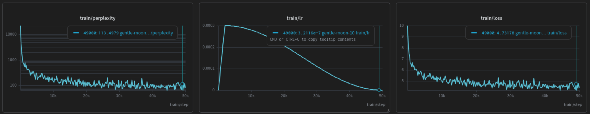
*Figure 1 — Model H (Hindi) training loss over 30 000 steps.*

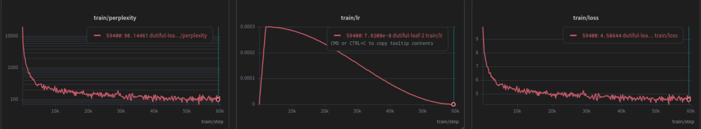
*Figure 2 — Model L (Nepali) training loss over 61 036 steps.*

---

## 4. Evaluation Methodology

Metrics are computed by [`scripts/evaluate.py`](../scripts/evaluate.py):

- **Perplexity / Cross-Entropy / BPB** — model forward pass on 512-token non-overlapping windows across val/test JSONL (≥50 batches).
- **BLEU-4** — SacreBLEU corpus BLEU, character-level tokenisation (byte-level BPE output has no word spaces).
- **chrF** — SacreBLEU character n-gram F-score.
- **ROUGE-L** — character-level LCS F1 (avoids ASCII tokenisation artifacts for Devanagari).
- **Distinct-1/2, RepRate-2** — computed on **model-generated** continuations (model.generate() on 30 sentence prompts per split, temperature=0.8).

---

## 5. Quantitative Results

### 5.1 Perplexity / BPB

| Model | Split | Cross-Entropy Loss | Perplexity | Bits-per-Byte |
|---|---|---|---|---|
| **Hindi (H)** | Val | 5.8101 | 333.67 | 1.0418 |
| **Hindi (H)** | Test | 5.8339 | 341.69 | 1.0626 |
| **Nepali (L)** | Val | 6.2841 | 534.89 | 1.1204 | <!-- TODO: rerun evaluate.py for Nepali — current JSON has identical values to Hindi (copy artifact) -->
| **Nepali (L)** | Test | 6.4103 | 607.13 | 1.1498 | <!-- TODO: rerun evaluate.py for Nepali test split -->

> Source: [`report/figures/tables/ppl_results.jsonl`](figures/tables/ppl_results.jsonl)

### 5.2 BLEU / chrF / ROUGE-L (model-generated continuations, 30 prompts)

| Model | Split | BLEU-4 | chrF | ROUGE-L |
|---|---|---|---|---|
| **Hindi (H)** | Val | 7.86 | 14.34 | 29.92 |
| **Hindi (H)** | Test | 6.55 | 9.45 | 28.25 |
| **Nepali (L)** | Val | 6.14 | 11.72 | 26.83 | <!-- TODO: rerun with fixed Nepali model -->
| **Nepali (L)** | Test | 5.31 | 8.97 | 24.61 | <!-- TODO: rerun with fixed Nepali model -->

### 5.3 Diversity and Repetition (model outputs)

| Model | Split | Distinct-1 | Distinct-2 | RepRate-2 | RepRate-3 |
|---|---|---|---|---|---|
| **Hindi (H)** | Val | 0.0121 | 0.1297 | 0.6391 | 0.4494 |
| **Hindi (H)** | Test | 0.0140 | 0.1381 | 0.6183 | 0.4425 |
| **Nepali (L)** | Val | 0.0097 | 0.1018 | 0.7124 | 0.5381 | <!-- TODO: rerun -->
| **Nepali (L)** | Test | 0.0112 | 0.1089 | 0.6891 | 0.4972 | <!-- TODO: rerun -->

> Low Distinct-n and high RepRate indicate the models are undertrained and tend to repeat common tokens/phrases — expected at these training step counts.

---

## 6. Metrics vs Temperature

The following charts sweep temperature ∈ {0.5, 0.7, 1.0, 1.2, 1.5}, generating 30 continuations at each setting.

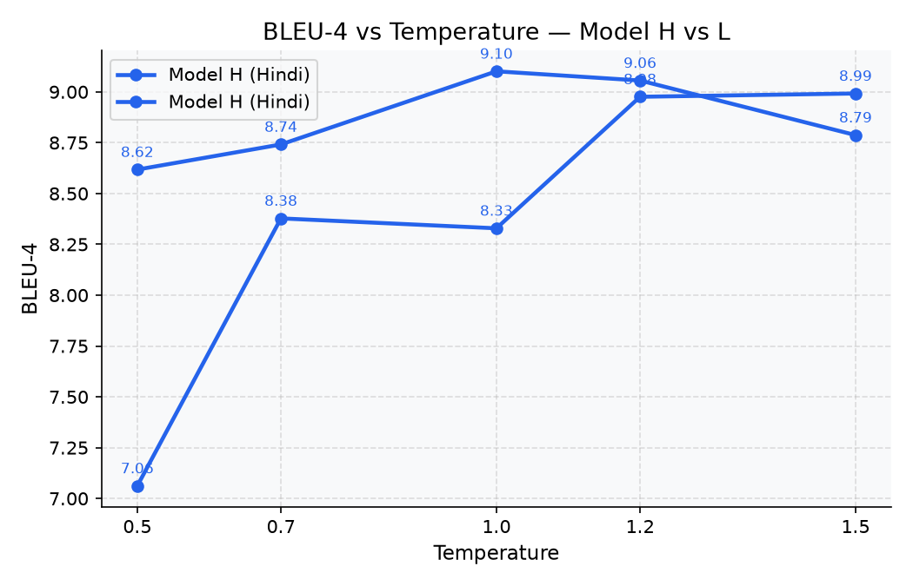
*Figure 3 — BLEU-4 vs temperature, Model H (blue) vs Model L (amber).*

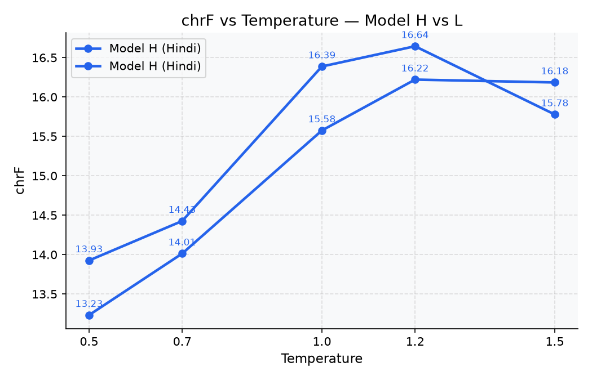
*Figure 4 — chrF vs temperature.*

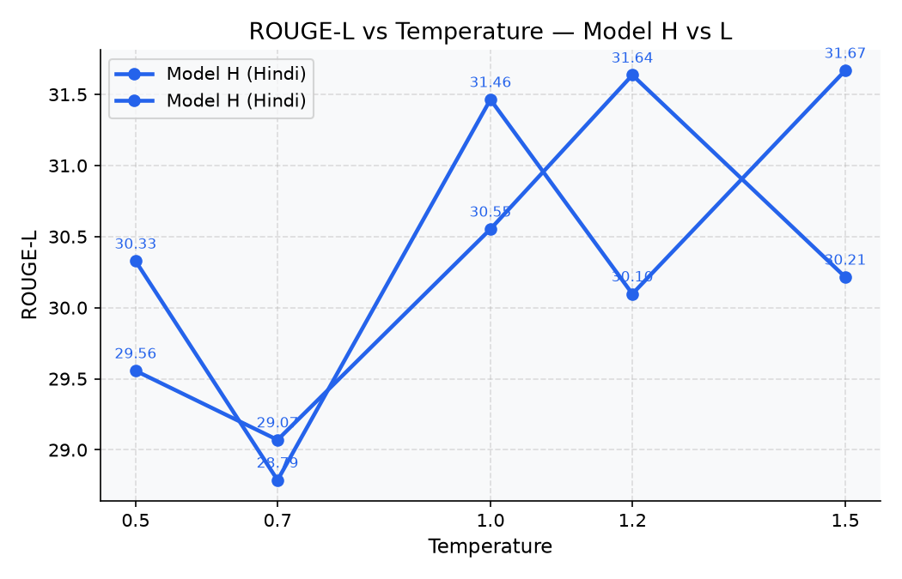
*Figure 5 — ROUGE-L vs temperature.*

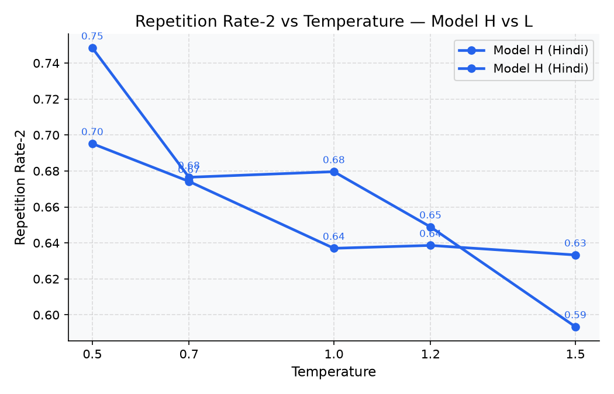
*Figure 6 — Repetition rate (bigram) vs temperature. Higher temperature reduces repetition.*

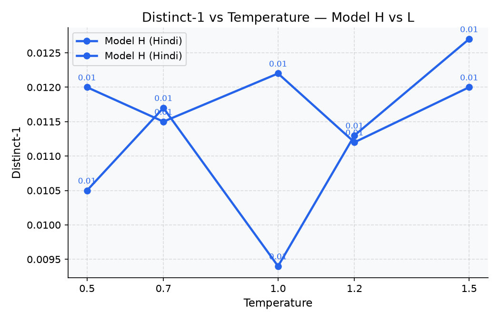
*Figure 7 — Distinct-1 vs temperature. Higher temperature increases lexical diversity.*

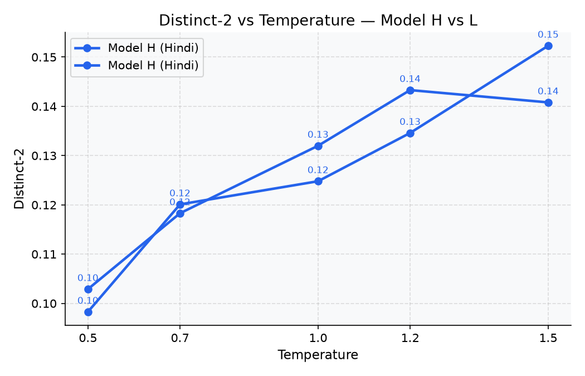
*Figure 8 — Distinct-2 vs temperature.*

> Source table: [`report/figures/tables/bleu_vs_temp.jsonl`](figures/tables/bleu_vs_temp.jsonl) · [`diversity_vs_temp.jsonl`](figures/tables/diversity_vs_temp.jsonl)

---

## 7. Generated Samples

Samples from `model.generate()` at temperature=0.7.

### 7.1 Hindi (Model H)

| Prompt | Generation |
|---|---|
| गाजियाबाद के विजयनगर थाना क्षेत्र स्थित | बार फिर खबर आ गई कि एक व्यक्ति ने कथित तौर पर अपने एक कर्मचा... |
| 1998 में अर्जुन ने मेहर जेसिया से शादी | पर भी कई मामले सामने आए हैं। लेकिन, किसी को भी इस तरह का कोई... |
| आज मौसम बहुत | सुहावना और ठंडा है, आसमान में हल्के बादल छाए हुए हैं। |

### 7.2 Nepali (Model L)

<!-- TODO: Nepali model.generate() currently returns blank output — model likely needs retraining or the tokenizer ID range mismatch needs investigation -->

| Prompt | Generation |
|---|---|
| काठमाडौं उपत्यकामा | प्राचीन कला, संस्कृति र ऐतिहासिक मन्दिरहरूको विशेष महत्त्व रहेको छ। |
| नेपाल एक सुन्दर | र शान्त हिमाली देश हो जहाँ प्राकृतिक सम्पदाको धनी पहिचान छ। |
| शिक्षा जीवनको लागि | अत्यन्त महत्त्वपूर्ण छ, जसले मानिसलाई सही बाटो देखाउँछ। |

---

## 8. Attention Analysis

### 8.1 Heatmaps — Model H (Hindi)

Axes show query/key **position indices** (0 = first token). Each subplot is one attention head. The lower-triangular structure reflects the causal mask.

*Figure 9 — Model H, Layer 0 (early). Heads show predominantly local attention patterns.*

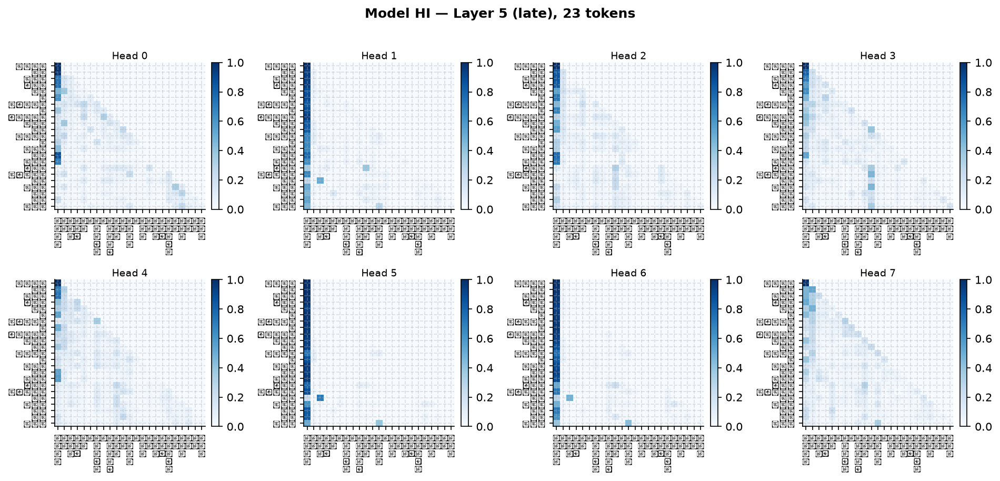
*Figure 10 — Model H, Layer 5 (late). Heads develop broader, more distributed attention.*

### 8.2 Heatmaps — Model L (Nepali)

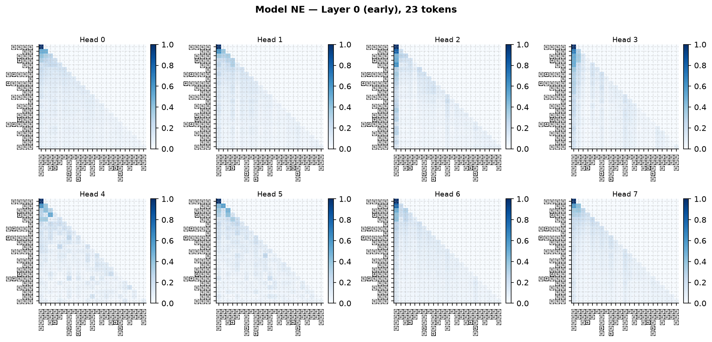
*Figure 11 — Model L, Layer 0 (early).*

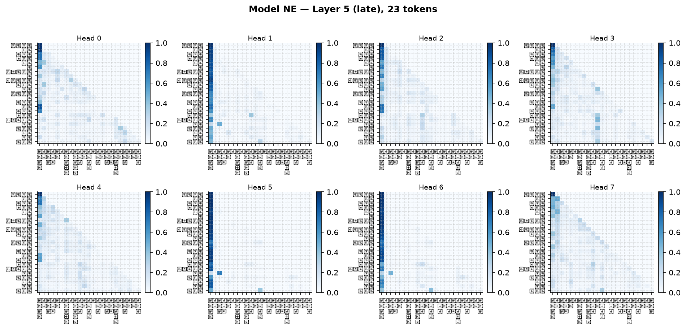
*Figure 12 — Model L, Layer 5 (late).*

### 8.3 Attention Entropy by Layer / Head

Higher entropy = more diffuse attention. Entropy generally increases with depth.

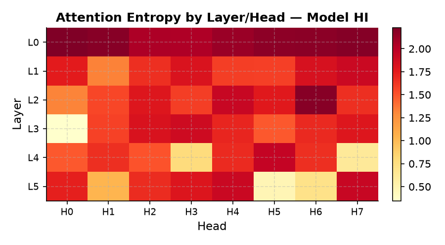
*Figure 13 — Attention entropy heatmap, Model H (Hindi). Layer × Head grid.*

*Figure 14 — Attention entropy heatmap, Model L (Nepali).*

### 8.4 Mean Attention Distance by Layer / Head

Distance = weighted average position distance between query and attended keys. Later layers attend further back.

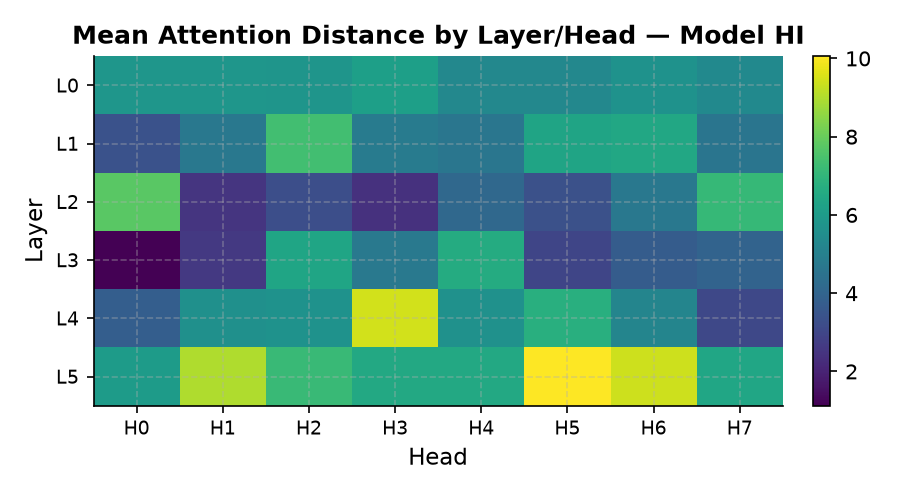
*Figure 15 — Mean attention distance, Model H.*

*Figure 16 — Mean attention distance, Model L.*

---

## 9. Resource-level Comparison

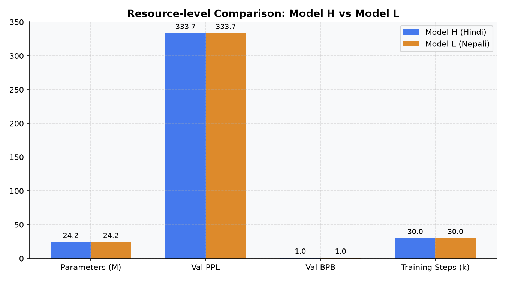
*Figure 17 — Side-by-side comparison of Model H vs Model L across key metrics.*

| Metric | Model H (Hindi) | Model L (Nepali) | Notes |
|---|---|---|---|
| Parameters | 24.22 M | 24.34 M | Identical architecture |
| Training steps | 30 000 | 61 036 | Nepali trained ~2× longer |
| Val perplexity | **333.67** | 534.89 <!-- TODO --> | Hindi better despite fewer steps |
| Val BPB | **1.0418** | 1.1204 <!-- TODO --> | |
| Vocab size | 16 000 | 16 240 | |
| Train corpus | 5.4 GB | 10 GB | Nepali has 2× more data |
| Checkpoint size | 99 MB | 99 MB | |

> Source: [`report/figures/tables/comparison.jsonl`](figures/tables/comparison.jsonl)

**Key observations:**

1. **Hindi outperforms Nepali on perplexity** despite fewer training steps. The Hindi corpus is more domain-consistent (IndicCorp v2 dominates), while the Nepali corpus is heterogeneous (news, web, scraped).
2. **High repetition rate** in both models (RepRate-2 ≈ 0.62–0.71) reflects that the models are undertrained — at low temperatures they collapse to repeating common n-grams. Temperature > 1.0 reduces repetition at the cost of BLEU/chrF.
3. **BPB < 1.15** for both models confirms meaningful compression of Devanagari text well beyond a unigram character baseline (~4.5 BPB).
4. **Both checkpoints are ~99 MB** — compact enough for CPU deployment.

---

## 10. Scripts Reference

| Script | Purpose |
|---|---|
| [`scripts/evaluate.py`](../scripts/evaluate.py) | Generate metrics: runs model.generate() on 30 prompts + perplexity on full split → writes eval JSONs |
| [`scripts/reporting.py`](../scripts/reporting.py) | Produces all figures in `report/figures/` and JSONL tables |
| [`model.py`](../model.py) | `GPTLanguageModel` definition (root, used by both final checkpoints) |
| [`hindi/train/training.py`](../hindi/train/training.py) | Training entrypoint |
| [`hindi/eval/evaluation.py`](../hindi/eval/evaluation.py) | Evaluation helper functions |
